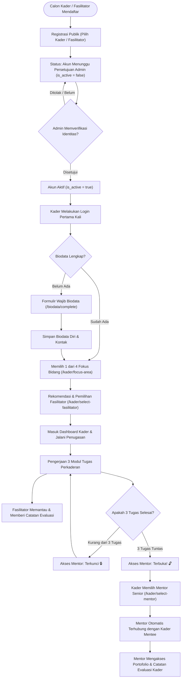

# Panduan Proses Bisnis Sistem Perkaderan IMM UINSA

Dokumen ini menjelaskan model proses bisnis, alur tata kelola perkaderan (*business logic*), pemetaan peran (*stakeholder mapping*), dan siklus bimbingan berjenjang yang diterapkan pada platform digital **Sistem Informasi Perkaderan IMM UIN Sunan Ampel Surabaya**.

---

## 1. Latar Belakang & Nilai Bisnis (Business Value)

Secara historis, proses perkaderan organisasi kemahasiswaan sering kali mengalami kendala berupa:
- **Taraf tindak lanjut (*follow-up*) pasca-Darul Arqam Dasar (DAD) yang belum terukur.**
- **Kurangnya segmentasi minat dan bakat kader**, sehingga potensi kader tidak tersalurkan secara optimal ke dalam pilar diaspora persyarikatan dan kebangsaan.
- **Ketiadaan rekam jejak evaluasi digital** yang terintegrasi antara pendamping lapangan (fasilitator) dan tokoh senior/alumni (mentor).

### 🎯 Nilai Tambah Platform:
1. **Targeted Talent Mapping:** Mengelompokkan kader ke dalam 4 bidang diaspora strategis sejak dini.
2. **Accountable & Progressive Milestone:** Mengunci hak akses mentoring senior hingga kader membuktikan komitmen awal melalui penyelesaian 3 penugasan nyata.
3. **Integrated Feedback Loop:** Setiap catatan evaluasi yang diberikan fasilitator tersimpan rapi di database dan otomatis menjadi dokumen portofolio bagi mentor senior.

---

## 2. Empat Pilar Rumpun Pergerakan Kader (Core Talent Pillars)

Sistem memetakan kaderisasi ke dalam 4 spesialisasi minat pergerakan:

| Rumpun Bidang | Target Profil Kader | Output & Diaspora Nyata |
| :--- | :--- | :--- |
| **1. Entrepreneur** | Wirausaha muda, pengembang bisnis kreatif, perintis UMKM & startup. | Anggota Jaringan Saudagar Muhammadiyah (JSM), pengelola unit usaha Amal Usaha Muhammadiyah (AUM), pendiri entitas bisnis mandiri. |
| **2. Politisi** | Calon pemimpin publik, analis kebijakan, diplomat, pegiat hukum. | Pengurus lembaga legislatif/eksekutif mahasiswa, staf ahli parlemen, analis kebijakan publik, aktivis advokasi sosial. |
| **3. Akademisi** | Peneliti ilmiah, pengajar, calon dosen, pegiat literasi dan riset. | Penerima beasiswa pascasarjana/doktoral, penulis jurnal terindeks, asisten peneliti laboratorium/kampus. |
| **4. Pengabdi Persyarikatan** | Penggerak dakwah kultural, kader tarjih, administrator persyarikatan. | Pimpinan Ranting/Cabang Muhammadiyah & Aisyiyah, pegiat Majelis/Lembaga Persyarikatan, kader pengelola AUM. |

---

## 3. Matriks Peran & Hak Akses (Role-Based Matrix)

```
┌────────────────────────────────────────────────────────────────────────┐
│                              SISTEM PERKADERAN                         │
├───────────────┬────────────────────────────────────────────────────────┤
│ Admin         │ Verifikasi pendaftaran, kontrol pengguna, tata kelola  │
│ Mentor        │ Supervisi strategis, bimbingan jejaring, arahan makro  │
│ Fasilitator   │ Bimbingan teknis berkala, koreksi tugas, evaluasi rutin│
│ Kader         │ Onboarding biodata, memilih bidang, submit 3 tugas     │
└───────────────┴────────────────────────────────────────────────────────┘
```

| Fitur / Alur Bisnis | Admin | Mentor | Fasilitator | Kader |
| :--- | :---: | :---: | :---: | :---: |
| Registrasi Akun Mandiri | ❌ | ❌ | ✅ | ✅ |
| Aktivasi / Persetujuan Akun | ✅ | ❌ | ❌ | ❌ |
| Pengisian Biodata Wajib | ❌ | ❌ | ✅ | ✅ |
| Pemilihan 4 Fokus Bidang | ❌ | ❌ | ❌ | ✅ |
| Pemilihan Fasilitator Pendamping | ❌ | ❌ | ❌ | ✅ |
| Pengerjaan & Pengumpulan Tugas | ❌ | ❌ | ❌ | ✅ |
| Pemberian Catatan Evaluasi / Feedback | ❌ | ❌ | ✅ | ❌ |
| Pemilihan & Akses Mentor Senior | ❌ | ❌ | ❌ | ✅ *(Setelah 3 Tugas)* |
| Melihat Profil Mentee Binaan & Rekam Jejak | ❌ | ✅ | ❌ | ❌ |

---

## 4. Diagram Alur Bisnis Lengkap (End-to-End Business Flow)



---

## 5. Rincian Fase Perjalanan Kader (The 5-Stage Journey)

### Fase 1: Gatekeeping & Verifikasi Keanggotaan
- Calon kader mendaftar mandiri via menu Register publik.
- Sistem secara ketat membatasi pendaftaran hanya untuk peran **Kader** dan **Fasilitator** (mencegah pendaftaran tidak sah sebagai Admin/Mentor).
- Formulir registrasi mewajibkan pemilihan peran (mengirim field `role`), tervalidasi oleh whitelist `Role::publicRoles()` di validator backend.
- Akun baru berstatus non-aktif (`is_active = false`) hingga Admin memverifikasi keabsahan komisariat pendaftar.
- Selama berstatus non-aktif, pengguna diarahkan ke halaman **Pending Approval** (`/dashboard`): nama pengguna beserta peran yang didaftarkan ditampilkan, dilengkapi tombol *Cek Status* dan *Logout*.

### Fase 2: Pengisian Data Pokok Organisasi (Mandatory Biodata)
- Hanya akun yang **sudah diaktivasi oleh Admin** yang dapat mengisi biodata; akun non-aktif terkunci sepenuhnya dari onboarding ini.
- Saat kader aktif login untuk pertama kali, sistem middleware `EnsureBiodataCompleted` mencegat seluruh akses dashboard.
- Kader diwajibkan melengkapi nomor WhatsApp aktif, tanggal lahir, jenis kelamin, domisili, dan asal komisariat/kampus.

### Fase 3: Pemetaan Minat & Pemasangan Fasilitator (Matching Process)
- Kader memilih salah satu dari 4 fokus bidang:
  1. *Entrepreneur*
  2. *Politisi*
  3. *Akademisi*
  4. *Pengabdi Persyarikatan*
- Setelah bidang dipilih, sistem secara cerdas menyaring dan merekomendasikan **Fasilitator** yang memiliki keahlian serumpun dengan kader.
- Kader memilih fasilitator yang akan menjadi pendamping taktis selama masa penugasan.

### Fase 4: Penugasan Berjenjang & Umpan Balik (Task & Evaluation Loop)
- Tersedia 3 tugas nyata berjenjang untuk masing-masing bidang (total 12 silabus tugas perkaderan).
- **Interaksi Fasilitator:**
  - Fasilitator dapat melihat nama seluruh kader binaannya pada dashboard fasilitator.
  - Fasilitator membaca tugas yang diselesaikan kader.
  - Fasilitator menuliskan catatan bimbingan, evaluasi tugas, atau rekomendasi karakter yang langsung tersimpan di database `kader_evaluations`.
- Kader dapat melihat seluruh catatan evaluasi dari fasilitatornya secara transparan pada dashboard pribadi.

### Fase 5: Kualifikasi Mentorship Senior (Unlocking Senior Mentorship)
- Sebelum menyelesaikan 3 tugas, fitur pemilihan mentor berstatus **Terkunci (*Locked*)**.
- Ketika tugas ke-3 dituntaskan, sistem secara otomatis membuka kunci pemilihan Mentor senior (*Unlocked*).
- Kader memilih salah satu **Mentor Senior** di bidangnya (tokoh alumni, pimpinan Muhammadiyah, atau profesional).
- **Integrasi Otomatis:**
  - Begitu kader memilih mentor, kader tersebut secara otomatis terdaftar di dashboard mentor sebagai mentee binaan.
  - Mentor senior langsung dapat memeriksa identitas kader, kontak WhatsApp, ringkasan 3 tugas, dan rekam jejak evaluasi fasilitator lapangan.

---

## 6. Aturan Bisnis Penting (Business Rules Engine)

> [!IMPORTANT]
> **Aturan 1 (Role Whitelist):**
> Pendaftaran publik hanya menerima role `kader` dan `fasilitator`. Usaha pendaftaran sebagai `admin` atau `mentor` akan ditolak secara otomatis oleh validator sistem.

> [!IMPORTANT]
> **Aturan 2 (No Biodata, No Dashboard):**
> Pengguna berstatus Kader dan Fasilitator tidak dapat mengakses dashboard atau modul tugas sebelum menyelesaikan pengisian formulir biodata.

> [!IMPORTANT]
> **Aturan 3 (Kualifikasi Mentor Minimum 3 Tugas):**
> Endpoint pemilihan mentor dilindungi proteksi otorisasi backend. Kader yang mencoba mengakses atau menyimpan mentor sebelum menuntaskan minimal 3 tugas akan menerima respon `403 Forbidden` / pengalihan otomatis.

> [!NOTE]
> **Aturan 4 (Otoritas Evaluasi Tunggal):**
> Hanya fasilitator yang secara resmi dipilih oleh kader yang berhak menulis dan menyimpan catatan evaluasi untuk kader tersebut.

> [!IMPORTANT]
> **Aturan 5 (Penguncian Akun Pending / Pending Approval Lock):**
> Akun dengan `is_active = false` tidak dapat mengakses onboarding biodata, dashboard, maupun modul manapun. Enklopsi yang dijalankan sistem:
> - Middleware `EnsureBiodataCompleted` mengalihkan seluruh permintaan dari akun non-aktif menuju halaman **Pending Approval** — termasuk upaya akses langsung `/biodata/complete`, yang kini juga dilindungi middleware `biodata.complete` pada rute tersebut.
> - Controller dashboard pusat merender halaman **Pending Approval** (stack Inertia) untuk akun non-aktif, tanpa membocorkan data binaan/tugas.
> - Aktivasi kembali ke jalur normal: keabsahan komisariat disetujui Admin → `is_active = true` → onboarding biodata → pemilihan fokus bidang.

---

## 7. Indikator Keberhasilan Bisnis (Key Performance Indicators)

1. **Rasio Kelulusan Milestone:** Persentase kader yang berhasil menyelesaikan 3 tugas perkaderan dalam periode 30 hari.
2. **Keterikatan Fasilitator (*Fasilitator Engagement*):** Rata-rata catatan evaluasi yang diberikan fasilitator per kader binaan.
3. **Konversi Mentorship:** Jumlah kader yang berhasil tersambung secara aktif dengan mentor senior di masing-masing dari 4 rumpun pergerakan.

---

## 8. Relasi Model Terkait

- [**`app/Models/User.php`**](file:///home/f1ru/Documents/IMM/kader/app/Models/User.php): Entitas pengguna dengan peran, relasi fasilitator, mentor, dan status aktivasi.
- [**`app/Models/Biodata.php`**](file:///home/f1ru/Documents/IMM/kader/app/Models/Biodata.php): Data pokok kader (relasi 1-to-1).
- [**`app/Models/Task.php`**](file:///home/f1ru/Documents/IMM/kader/app/Models/Task.php): Modul penugasan berdasarkan fokus rumpun.
- [**`app/Models/KaderTask.php`**](file:///home/f1ru/Documents/IMM/kader/app/Models/KaderTask.php): Riwayat pengerjaan tugas kader.
- [**`app/Models/KaderEvaluation.php`**](file:///home/f1ru/Documents/IMM/kader/app/Models/KaderEvaluation.php): Catatan evaluasi berkala dari fasilitator untuk kader.

